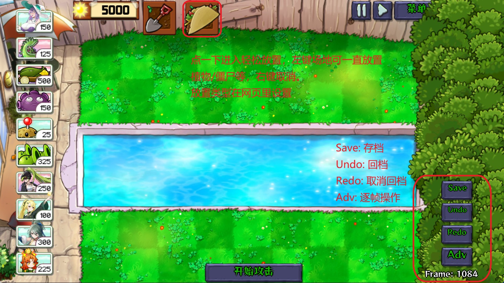

# PGvZ-TAS

[English](README_EN.md) | 简体中文

植物娘大战僵尸自动脚本框架、修改器及 TAS 工具。by yuchenxi2000

> 植物娘大战僵尸（PlantGirls vs. Zombies，PGvZ）是植物大战僵尸的社区改版，游戏作者[庄不纯](https://space.bilibili.com/20530305)

## 快速开始

先下载适用于当前游戏版本的发布 ZIP。 [发布下载](https://github.com/yuchenxi2000/PGvZ-TAS/releases)

**PC**：运行 `cp-cheat-mods.bat` 自动安装，或手动将 `pgvz/`、`pgvztool/`、`gui/`、`cheat-gui.py` 复制到 mods 目录。启动游戏后，在主界面点击「修改器」，或在浏览器中打开 `http://localhost:58080`。

**安卓**：将以上文件复制到 mods 目录。启动游戏后，在主界面点击「修改器」，或在浏览器中打开 `http://localhost:58080`。（你可能需要一个文件管理器来复制文件，比如 MT 管理器）

mods 目录位置：

| 平台 | 路径 |
|---|---|
| PC | `C:\Users\{用户名}\AppData\Roaming\ZBC\PlantGirlsVsZombies\mods` |
| 安卓 | `/storage/emulated/0/Android/data/net.pvz.pgvz.zbcteam/files/mods` |

将 `{用户名}` 替换为 `C:\Users` 下当前 Windows 账户的文件夹名。`AppData` 默认隐藏，可将完整路径粘贴到文件资源管理器地址栏打开。

等网页页眉显示「可操作」后即可使用普通功能。 [安装步骤和故障排查](docs/mod/user-guide/install.md)

## 修改器功能、TAS 工具使用

- **常用修改**：免费用卡、随意种植、植物/僵尸无敌、暂停出怪等几十项开关
- **场地放置**：直接在网页里选择植物/僵尸/物品类型，点击按钮放置到场地
- **轻松放置**：在「场地」页打开「启用轻松放置」并设置「轻松放置模式」。进关后点击玉米饼（Taco）图标激活，铲子和手套同时显示时图标在菜单右侧。PC 左键放置、右键退出。安卓点按场地放置，再点图标退出。选择传送门模式可移动传送门。
- **TAS 工具**：在「基础」页的「常用修改」中打开「启用 TAS」。右下角会显示 Save（存档）、Undo（回到上一个存档点，实时游玩时先存档）、Redo（前进到下一个存档点）、Adv（运行一帧后暂停）和帧计数器。
- **自定义快捷键**：可重新绑定选择种子包、铲子、手套、轻松放置、TAS 按钮、暂停游戏等按键，已适配常见非英文输入法，详见 [docs/mod/user-guide/keybinds.md](docs/mod/user-guide/keybinds.md)

下面的游戏截图以 PC 操作为例。

## 脚本编写

`pgvz` 模块提供完整的脚本框架，包括选卡、时间控制、炮管理、脚本调度等。脚本用生成器函数编写，注册到 `script_manager` 后随游戏帧自动运行。

脚本编写与使用详见 [docs/mod/user-guide/scripting.md](docs/mod/user-guide/scripting.md)。

游戏 v1.3.0 的本地 DIY 关卡、在线关卡缓存、JSON 组件格式及运行机制见
[自定义关卡与在线关卡](docs/game-mechanics/levels/creative-levels.md)。

## 开源协议

MIT License

## 致谢

布阵码数据来自 PvZToolkit（感谢 lmintlcx）。
