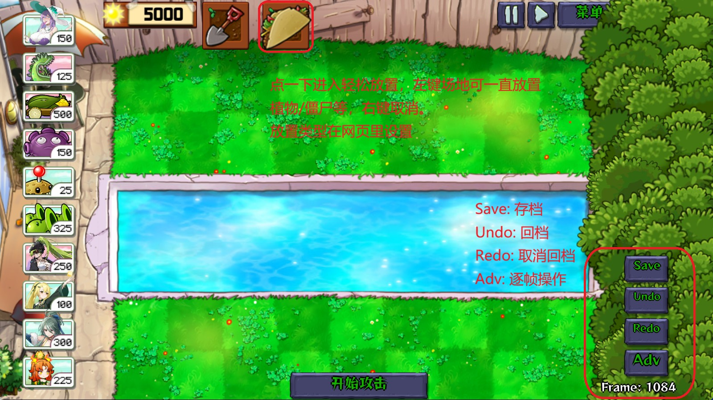

# PGvZ-TAS

English | [简体中文](README.md)

A scripting framework, cheat mod, and TAS tool for PlantGirls vs. Zombies (PGvZ). by yuchenxi2000

> PlantGirls vs. Zombies (PGvZ) is a community mod of Plants vs. Zombies by [庄不纯](https://space.bilibili.com/20530305)

## Quick Start

Download the release ZIP that matches your game version. [Releases](https://github.com/yuchenxi2000/PGvZ-TAS/releases)

**PC**: Run `cp-cheat-mods.bat` for automatic installation, or manually copy `pgvz/`, `pgvztool/`, `gui/`, `cheat-gui.py` into the mods directory. Launch the game and open `http://localhost:58080` in your browser.

**Android**: Copy the above files into the mods directory, launch the game, and open `http://localhost:58080` in your browser. (You may need a file manager app such as MT Manager to copy files.)

Mods directory location:

| Platform | Path |
|---|---|
| PC | `C:\Users\{username}\AppData\Roaming\ZBC\PlantGirlsVsZombies\mods` |
| Android | `/storage/emulated/0/Android/data/net.pvz.pgvz.zbcteam/files/mods` |

Replace `{username}` with your Windows account folder name under `C:\Users`. `AppData` is hidden by default. Paste the full path into File Explorer’s address bar to open it.

Wait for “Ready” in the header before using the regular controls. [Installation and troubleshooting (Chinese)](docs/mod/user-guide/install.md)

## Cheat Mod & TAS Tool

- **Common cheats**: Free plants, plant anywhere, plant/zombie invincibility, stop spawning, and dozens more toggles
- **Item placement**: Select plant/zombie/item types and properties in the web UI, then click to place them on the field
- **Quick place**: In Board, turn on “Enable Easy Place” and set “Easy Place Mode,” then click the Taco icon in-game. When both the shovel and glove are visible, look to the right of the menu. On PC, left-click to place and right-click to exit. On Android, tap the board to place and tap the Taco icon again to exit.
- **TAS tool**: In Basics, turn on “Enable TAS” in “Common Cheats.” The bottom-right corner shows Save, Undo (save the current state first if playing live), Redo, Adv (advance one frame and pause), and a frame counter.
- **Custom keybinds**: Rebind seed packet selection, shovel, glove, quick place, TAS actions, pause and other keys. Common non-English input methods are supported. See [docs/mod/user-guide/keybinds.md](docs/mod/user-guide/keybinds.md)

The screenshot shows the PC controls for Easy Place and TAS.

## Scripting

The `pgvz` module provides a complete scripting framework including card selection, timing control, cob cannon management, and script scheduling. Scripts are written as generator functions and registered with `script_manager` to run alongside game frames.

See [docs/mod/user-guide/scripting.md](docs/mod/user-guide/scripting.md) (Chinese) for scripting guides and tutorials.

## License

MIT License

## Credits

Lineup data from PvZToolkit (thanks to lmintlcx).
